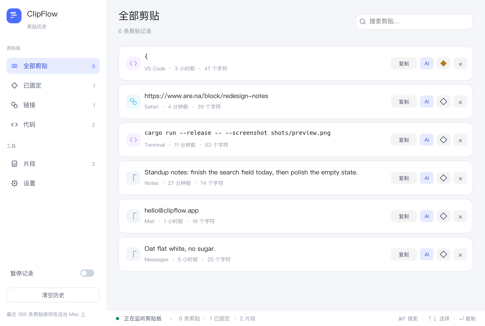
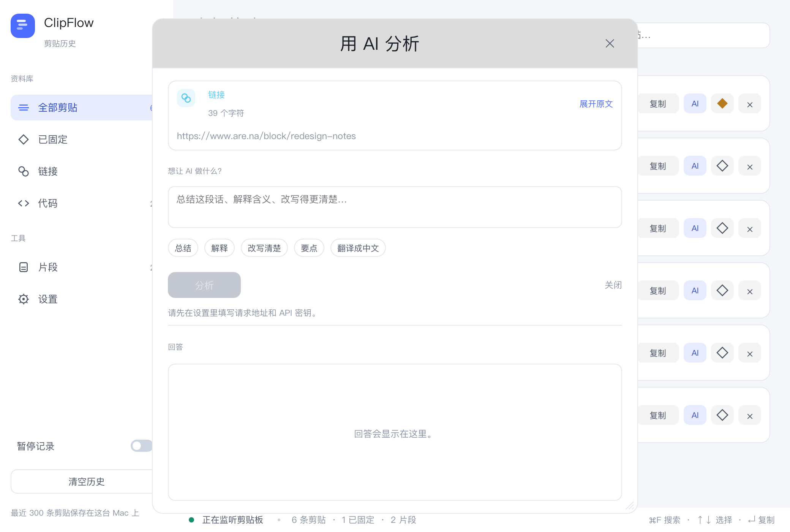
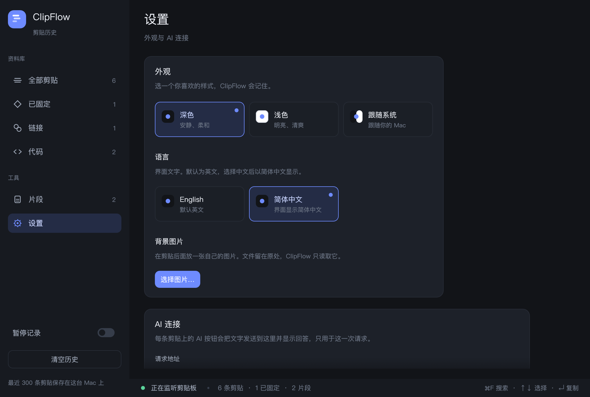
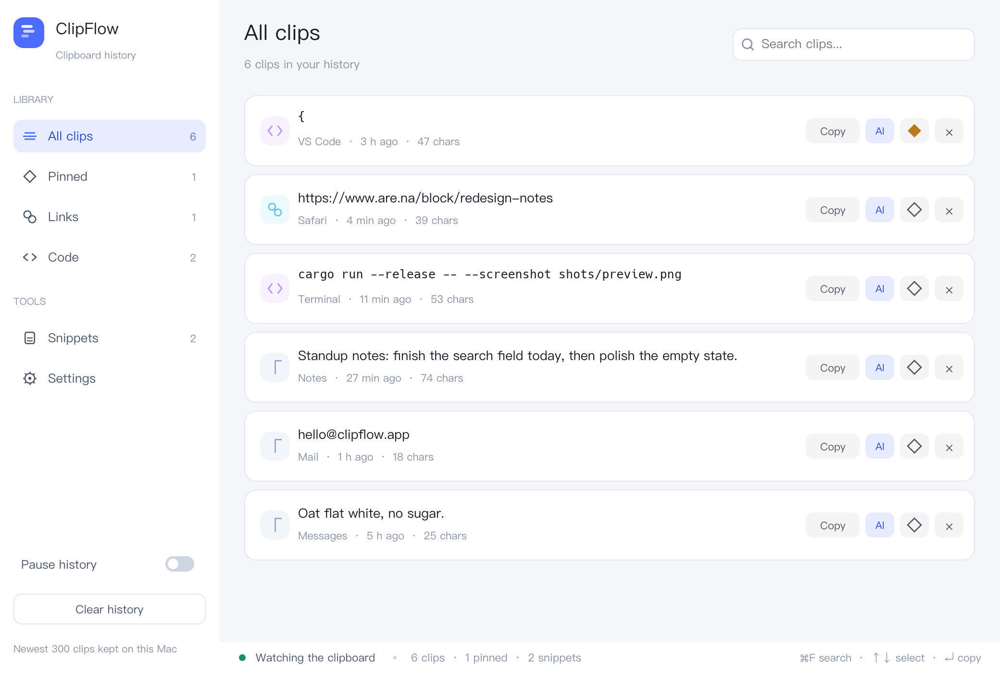

# ClipFlow

一个简洁的 macOS 剪贴板管理工具：自动记下复制过的文字，可以搜索、固定、复制回去，也能让 AI 帮你总结某一条。

*English: ClipFlow is a small macOS clipboard manager written in Rust with egui (eframe). It keeps your recent clips, lets you search, pin, copy them back and save your own snippets, and can ask any OpenAI-compatible API to analyse a clip. It lives in the menu bar, keeps its data on your own machine, and builds for macOS and Windows.*

## 功能

- 自动记录复制过的文字（最近 300 条），只在这台电脑上
- 搜索、固定、删除、一键复制回去
- 自己保存常用片段
- 每条记录都能让 AI 分析：地址、模型、密钥都在设置里填，任何兼容 OpenAI 接口的服务都可以
- 深色 / 浅色 / 跟随系统三种主题，还能换成自己的桌面图片并调暗
- 界面可切中文或 English
- 住在屏幕顶部的菜单栏里，点一下显示或隐藏，不用时不再占着一块地方

## 截图

| 主界面 | AI 分析 |
| --- | --- |
|  |  |

| 设置 | English |
| --- | --- |
|  |  |

## 从源码构建（macOS）

需要 Rust（https://rustup.rs），macOS 11 或更新。

```bash
cargo build --release
./target/release/clipflow
```

打成 DMG 安装包：

```bash
./make-dmg.sh     # 生成 ClipFlow.dmg
```

> `app/.cargo/config.toml` 把 crates.io 换成了 rsproxy 镜像，在某些网络下更顺。
> 如果你在其他网络下构建有问题，或者想直接用官方源，删掉这个文件即可。

## 无界面截图

给自动化或文档用的一个参数：程序打开后画大约 100 帧，存成 PNG 再退出，全程不抢焦点。

```bash
./target/release/clipflow --screenshot out.png
CLIPFLOW_SIZE=820x520 ./target/release/clipflow --screenshot small.png   # 改窗口大小
```

## Windows

Mac 上做好的 DMG 不能直接给 Windows 用，需要在 Windows 电脑上打包，步骤见 [WINDOWS.md](WINDOWS.md)。
`windows/` 里有打包脚本和一个可选的 GitHub Actions 配置。

## 数据存在哪里

- macOS：`~/Library/Application Support/ClipFlow/state.json`
- Windows：`%LOCALAPPDATA%\ClipFlow\state.json`

就这一个文件，删掉它等于清空全部记录和设置。

## 关于 AI

不填地址和密钥也能正常记录剪贴板。填好之后，设置里的「测试连接」会真的发一条请求确认可用。
请求只会发到你填的那个地址，代码里没有任何内置的密钥或上报。

## 项目结构

| 文件 | 作用 |
| --- | --- |
| `src/main.rs` | 启动、`--screenshot` 参数 |
| `src/app.rs` | 状态、保存、剪贴板轮询、AI 调用 |
| `src/ui.rs` | 界面 |
| `src/ai.rs` | AI 请求和设置项 |
| `src/menu_bar.rs` | macOS 菜单栏（只在 macOS 编译） |
| `assets/` | 应用图标和菜单栏图标 |
| `shots/` | 上面那些界面截图 |
| `windows/` | Windows 打包脚本 |
| `make-dmg.sh` | 打包 macOS DMG |

## 发布到 GitHub

**仓库要以 `app` 这个文件夹为准，不要在有 `app` 的那一层初始化 Git** —— 外层目录里还有别的东西，会把它们一起传上去。

1. 在 GitHub 网页上新建一个空仓库，**不要**勾选任何初始化文件（README、.gitignore、License 都不要勾）。
2. 然后：

```bash
cd /path/to/clipflow/app
git init
git add .
git commit -m "ClipFlow: a simple macOS clipboard manager in Rust + egui"
git branch -M main
git remote add origin https://github.com/<你的用户名>/<仓库名>.git
git push -u origin main
```

`.gitignore` 已经排除了 `target/`、`build/`、`ClipFlow.app`、`*.dmg` 和 `.DS_Store`，这些不会被传上去。

可选：把 `windows/github-actions-build-windows.yml` 复制成 `.github/workflows/build-windows.yml`，之后每次推送都会自动打一个 Windows 版。

## 许可证

MIT，见 [LICENSE](LICENSE)。
